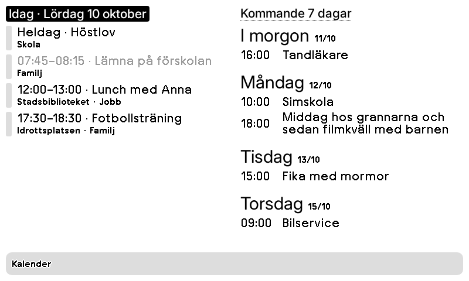

# Kalender – idag och kommande vecka

Plugin för [TRMNL](https://trmnl.com) (e-pappersskärm). Dagens händelser till vänster och de kommande sju dagarna till höger, grupperat per dag. Långa titlar bryts på två rader och avklarade händelser grånas.



Alla fyra layouter (full, half_horizontal, half_vertical, quadrant) finns, så den fungerar i mashups.
Se [`preview/overview.png`](preview/overview.png).
Testad i liggande och stående format samt på TRMNL X: [stående](preview/full.portrait.png), [TRMNL X](preview/full.x.png).

## Inställningar

- **Kalender-pluginens ID** – ID för din vanliga TRMNL-kalender (Google, Apple, Outlook, CalDAV, ICS), siffran i `/plugin_settings/<id>/edit`
- **API-nyckel** – konto-API-nyckel med läsbehörighet; skriv `demo` för exempeldata
- **Dagar framåt** – standard 7

## Installera

**Import:** zippa innehållet i `src/` (platt, inga mappar) och välj TRMNL → Plugins → Private Plugin → **Import new**.

```sh
cd src && zip ../kalender.zip * && cd ..
```

**[trmnlp](https://github.com/usetrmnl/trmnlp):**

```sh
trmnlp login    # en gång
trmnlp push     # laddar upp src/; lägg sedan till id: i src/settings.yml
trmnlp serve    # förhandsvisning på http://localhost:4567 med värdena i .trmnlp.yml
```

## Om

Läser händelser via [TRMNL:s plugin-data-API](https://docs.trmnl.com/go/private-api/plugin-data), så delade kalendrar, återkommande händelser och dubbletter hanteras av TRMNL:s inbyggda integration.

## Licens

[MIT](LICENSE)
